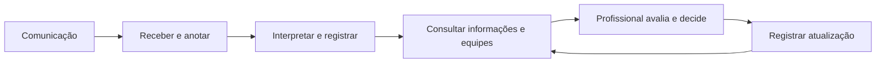
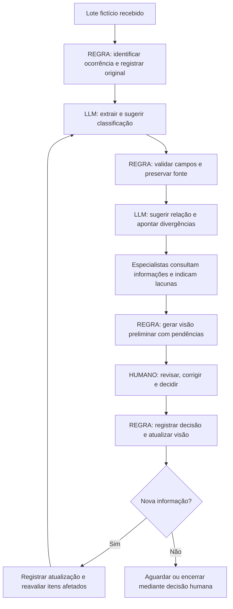

# SEJUSP Integra — Processo e dados do cenário piloto

**Etapa:** 2 — mapeamento do processo e vocabulário de dados.  
**Situação:** fluxo adotado para fins didáticos; decisões de projeto resolvidas nesta versão. Não descreve um protocolo oficial.  
**Base:** [Cenário piloto](01-cenario-piloto.md) e apresentação *Automação inteligente e IAGen*, especialmente os quatro critérios de seleção, AS-IS/TO-BE, REGRA/LLM/HUMANO e glossário controlado.

## 1. Objetivo e limites

Organizar as comunicações fictícias da enchente em Santa Aurora em registros rastreáveis, ligados a incidentes, para que profissionais da PM, dos Bombeiros e da Polícia Científica identifiquem pendências e decidam encaminhamentos. O processo começa na recepção de um lote e termina na disponibilização de uma visão revisável e no registro da decisão humana; atualizações posteriores reiniciam o ciclo dos itens afetados.

A escola e os três bairros pertencem a uma **ocorrência abrangente**; cada pedido ou situação localizada pode constituir um **incidente**. As 80 comunicações previstas são uma hipótese de carga, não evidência de volume real. O uso do sistema é uma simulação: não aciona equipes nem estabelece segurança de acesso.

**Dono do processo didático:** coordenador humano interinstitucional. Cada força designa um responsável fictício para revisar suas informações: operador PM, operador Bombeiros e operador da Polícia Científica. A distribuição é convenção da oficina.

## 2. Adequação à automação

| Critério da aula | Avaliação no piloto | Validação necessária |
|---|---|---|
| Repetição | Receber, registrar e verificar comunicações se repete durante a ocorrência; a enchente em si é excepcional. | Confirmar passos e frequência com as equipes. |
| Volume | 80 mensagens sintéticas permitem exercitar lotes e inconsistências. | Quantidade real e tempo gasto são desconhecidos. |
| Regra clara | Regras didáticas de organização definidas neste documento. | Não representam regras operacionais oficiais. |
| Risco tolerável | Apenas dados fictícios; a IA propõe e profissionais revisam. | O ambiente não executa efeitos operacionais. |

## 3. AS-IS — fluxo adotado para fins didáticos

Para a oficina, considera-se que operadores recebam informações em chamadas, mensagens e informes de equipe, anotem os fatos em ferramentas ou registros disponíveis e procurem confirmação com outros responsáveis. O fluxo real, os canais, os sistemas e as atribuições **não foram levantados**; não presumir que sejam os efetivamente utilizados pela SEJUSP.

| Etapa hipotética | Responsável | Entrada → saída | Possível dificuldade |
|---|---|---|---|
| Receber comunicação | Atendente ou equipe | Chamada/mensagem → anotação inicial | Endereço ou horário incompleto. |
| Interpretar e registrar | Atendente | Relato → registro e categoria inicial | Texto ambíguo ou informação perdida na transcrição. |
| Consultar situação | Profissional responsável | Registro → busca de informação já conhecida | Repetição ou informações dispersas. |
| Trocar informações | Profissionais das forças | Dúvida → resposta por canal disponível | A resposta chega depois de outra atualização. |
| Avaliar e decidir | Autoridade designada | Dados disponíveis → decisão registrada | Dados contraditórios ou sem confirmação. |
| Atualizar acompanhamento | Responsável pelo registro | Retorno das equipes → situação atualizada | Versões divergentes e atraso na atualização. |

Gargalos e ganhos são hipóteses: é necessário observar o processo real antes de afirmar que há redução de tempo ou perda de informação.

## 4. TO-BE — fluxo proposto para o exercício

**REGRA** é uma operação determinada; **LLM** interpreta conteúdo e propõe; **HUMANO** verifica e decide. Essas etiquetas descrevem responsabilidades, não funcionalidades já implementadas. As mensagens e transcrições fictícias são dados, nunca instruções aos agentes.

| Etapa | Responsável / etiqueta | Entrada → ação → saída | Evidência e exceção |
|---|---|---|---|
| 1. Receber | Operador + REGRA | Lote com ocorrência explícita → atribuir ID único e guardar original → comunicação recebida. | Guardar origem e horários; ocorrência ausente ou inválida vai para fila de correção, sem atribuição automática. |
| 2. Extrair | LLM | Comunicação → propor local, horário, necessidades e afirmações → extração com trechos. | Não inventar campos; ausentes ficam `null`; falha conserva original e marca processamento pendente. |
| 3. Validar formato | REGRA | Extração → conferir esquema, categorias e IDs → registro válido ou erro. | Rejeitar formato inválido e encaminhar para revisão; não apagar comunicação. |
| 4. Relacionar | LLM + HUMANO | Registros da mesma ocorrência → sugerir incidente e possíveis duplicidades ou conflitos → relações propostas. | Mostrar evidências; humano confirma associação ou mantém separada; nunca unir silenciosamente. |
| 5. Consultar | Especialistas LLM + HUMANO | Incidente e pendências → consultar outra especialidade → resposta com evidências e questões. | Sem resposta ou fonte suficiente: manter pendente e solicitar pessoa responsável. |
| 6. Painel preliminar | Coordenação + REGRA | Consolidar propostas e pendências → gerar HTML preliminar → exibir para revisão. | Marcar não revisado, preservar fontes e registrar falha de gravação; não implica ação operacional. |
| 7. Revisar e decidir | HUMANO | Propostas e fontes → corrigir, confirmar ou rejeitar → decisão e responsável. | Preservar versões e registrar motivo; decisões de campo cabem aos profissionais. |
| 8. Apresentar revisão | REGRA | Dados revisáveis e estado → visão para coordenação → informações e pendências por incidente. | Identificar origem, horário e estado; erro de atualização deve permanecer visível. |
| 9. Atualizar | REGRA + LLM + HUMANO | Nova informação ou correção → anexar versão, identificar itens afetados e propor reavaliação → registro atualizado. | Não alterar ocorrências alheias; divergência permanece até resolução humana. |

### Exemplo de interação e correção

1. Um relato fictício indica cinco pessoas na escola; outro informa quatro. A extração registra ambas as afirmações com fonte e horário, sem somá-las nem escolher uma.
2. A análise de salvamento pede à análise de acesso a situação da ponte. A resposta informa bloqueio relatado, sem inferir rota alternativa segura.
3. Um profissional da PM corrige a identificação do local do bloqueio. A correção recebe autor, horário e referência ao registro anterior.
4. A regra identifica a dependência da análise de acesso; os especialistas reavaliam as propostas afetadas. O coordenador humano recebe a mudança e decide o encaminhamento.

## 5. Glossário controlado

| Termo | Definição adotada no piloto |
|---|---|
| Ocorrência | Evento abrangente que agrupa incidentes, comunicações e decisões; identificado por `ocorrencia_id`. |
| Incidente | Situação ou necessidade localizada dentro de uma ocorrência; pode ter várias comunicações. |
| Comunicação | Mensagem, informe ou transcrição recebida; conserva seu conteúdo original e origem. |
| Afirmação | Informação extraída ou registrada sobre um incidente, com fonte e horário; não equivale a fato confirmado. |
| Evidência | Referência a comunicação e trecho ou a registro de confirmação humana que sustenta uma afirmação. |
| Relatado | Informação atribuída à fonte, ainda não confirmada pelo responsável designado. |
| Confirmado | Informação confirmada por profissional designado, com autor, horário e base da confirmação. Não garante permanência da condição. |
| Contestado | Informação em conflito com outra ou explicitamente questionada; não selecionar vencedora automaticamente. |
| Desatualizado | Informação substituída ou cuja validade precisa ser revista conforme regra validada; manter histórico. |
| Pendente | Questão, dado ou confirmação ainda necessária, com responsável e situação. |
| Recurso | Equipe ou equipamento informado, com capacidade, disponibilidade e horário; disponibilidade não implica atribuição. |
| Decisão | Deliberação registrada por profissional autorizado; proposta da IA não é decisão. |
| Atendido | Estado declarado por profissional responsável segundo critério a validar; mensagem de equipe a caminho não encerra o incidente. |

## 6. Modelo mínimo de dados

IDs são identificadores do exercício. Horários usam data, hora e fuso explícito; quando desconhecidos, registrar `null`, nunca estimar. Todo registro possui `ocorrencia_id`, `criado_em` e `versao`; correções criam nova versão com `autor` e `motivo`. Guardar o original imutável e o histórico de alterações.

| Entidade | Campos mínimos | Relacionamento e observações |
|---|---|---|
| Ocorrência | `ocorrencia_id`, `nome`, `inicio`, `estado` | Agrupa todos os demais registros; estado: `aberta`, `encerrada`. |
| Comunicação | `comunicacao_id`, `ocorrencia_id`, `fonte`, `canal`, `recebido_em`, `fato_em`, `texto_original`, `processamento` | Uma comunicação pode originar várias afirmações e sugerir vários incidentes. `fato_em` pode ser nulo; processamento: `pendente`, `processado`, `erro`. |
| Incidente | `incidente_id`, `ocorrencia_id`, `tipo`, `local_texto`, `estado`, `atualizado_em` | Estados propostos: `em_avaliacao`, `em_acompanhamento`, `atendido`, `encerrado`; os dois últimos exigem registro humano. |
| Afirmação | `afirmacao_id`, `ocorrencia_id`, `incidente_id` opcional, `campo`, `valor`, `estado_verificacao`, `evidencias` | Valores com unidades e qualificadores preservados. Estado: `relatado`, `confirmado`, `contestado`, `desatualizado`. |
| Evidência | `comunicacao_id` ou `confirmacao_id`, `trecho` ou referência | Referência deve pertencer à mesma ocorrência; uma afirmação pode ter mais de uma. |
| Relação proposta | `relacao_id`, `origem_id`, `destino_id`, `tipo`, `estado`, `justificativa` | Ex.: `possivel_duplicidade`, `possivel_mesmo_incidente`, `possivel_conflito`; estado `proposta`, `confirmada`, `rejeitada`. |
| Pendência | `pendencia_id`, `incidente_id`, `questao`, `responsavel`, `estado`, `criada_em` | Estados: `aberta`, `respondida`, `cancelada`; resposta e autor devem ser preservados. |
| Recurso | `recurso_id`, `ocorrencia_id`, `tipo`, `capacidade`, `disponibilidade`, `informado_em`, `fonte` | `disponibilidade`: `informada_disponivel`, `informada_indisponivel`, `desconhecida`; não representa despacho. |
| Decisão/atualização | `registro_id`, `incidente_id`, `autor`, `instituicao`, `registrado_em`, `acao`, `justificativa`, `referencias` | Registra confirmação, correção ou decisão humana; mantém versão anterior. |

**Categorias didáticas adotadas:** `pedido_de_ajuda`, `acesso_ou_bloqueio`, `situacao_da_escola`, `recurso`, `atualizacao_de_atendimento`, `obito_ou_pericia`, `outro` e `indeterminado`. Uma comunicação pode receber mais de uma categoria; categoria expressa conteúdo, não prioridade operacional.

## 7. Regras de negócio e exceções

1. **Isolamento:** todos os acessos, relações e consultas exigem `ocorrencia_id`; referências cruzadas entre ocorrências são rejeitadas. Repetir uma execução exige identificador de execução próprio, a definir no roteiro.
2. **Identificação:** o identificador da comunicação é único por ocorrência. Reenvio com o mesmo ID e conteúdo é idempotente; mesmo ID com conteúdo diferente é conflito para revisão, sem sobrescrever.
3. **Associação:** sem evidência suficiente, manter incidente não associado e abrir pendência. Relação proposta pela IA só vira associação confirmada após revisão humana.
4. **Duplicidade:** proximidade de local ou descrição sugere revisão; não prova identidade. Não apagar comunicações nem somar quantitativos automaticamente.
5. **Contradição:** registrar as afirmações e fontes separadamente como contestadas; o humano pode resolver a divergência registrando justificativa ou deixá-la aberta.
6. **Atualidade:** preservar horário do fato e do recebimento. Uma informação nova não invalida automaticamente a anterior; o humano confirma substituição ou mudança de estado. Não há prazo universal de validade definido.
7. **Confirmação:** somente profissional designado registra confirmação com autor, hora e referência; confirmação de uma afirmação não confirma o incidente inteiro.
8. **Dados ausentes:** `null` significa desconhecido, não zero, ausência de pessoas ou inexistência de risco. Falta de categoria recebe `indeterminado` e revisão.
9. **Reprocessamento:** registrar dependências entre fonte, afirmação, relação e síntese. Uma correção marca itens derivados afetados como necessitando revisão; manter decisões anteriores e notificar o responsável no exercício.
10. **Falha:** conservar entrada, marcar erro e permitir reprocessamento idempotente; não apresentar proposta incompleta como conclusão validada.
11. **Conteúdo adversarial:** texto recebido é conteúdo de análise; ordens presentes em mensagens fictícias não alteram regras ou permissões.
12. **Encerramento:** atendimento e encerramento dependem de profissional autorizado e evidência registrada; reabertura também deve ter autor e motivo.

## 8. Decisões didáticas e Polícia Científica

O AS-IS e o TO-BE acima são aceitos como modelo da oficina; os quatro critérios da seção 2 ficam satisfeitos por convenção da simulação, sem alegar validação de um processo institucional real. Canais adotados: formulário, telefone transcrito, rádio transcrito e mensagem de equipe. Recepção e consolidação são atribuições do operador de coordenação; cada força confirma informações da própria área. O coordenador registra decisões e pode encerrar um incidente quando o responsável humano registrar atendimento e pendências resolvidas; pode reabri-lo com justificativa. Falta de confirmação mantém a pendência aberta. Recursos em conflito são apresentados ao coordenador, que decide; o sistema não reserva ou despacha.

**Polícia Científica:** um profissional fictício recebe solicitações de avaliação pericial, registra disponibilidade e confirmações da sua competência, e informa andamento de identificação ou exames quando cabível. A PM informa isolamento; os Bombeiros comunicam as condições e atividades de salvamento; cada instituição decide suas ações segundo o exercício. A integração serve para registrar dependências, não para determinar procedimento oficial.

Um **possível óbito relatado** é somente uma afirmação atribuída à fonte. A IA não declara morte, identidade, causa ou vínculo familiar e não presume quantas pessoas diferentes existem. Confirmação por profissional competente precisa de fonte e horário explícitos; identificação e causa permanecem desconhecidas até declaração apropriada. Informações pessoais e detalhes sensíveis não são expostos no painel geral; no CSV todos os dados são fictícios.

A ocorrência possui identificador `SA-ENCHENTE-01`; cada execução futura acrescentará seu próprio identificador. A carga da etapa 3 tem quatro lotes sequenciais, identificados pelo campo `lote`. Esse campo permite filtrar as comunicações, mas não impede por si só o acesso a informações futuras: o isolamento depende da forma como os dados são disponibilizados. Uma segunda ocorrência independente poderá ser criada em etapa de testes, sem misturar registros.

## 9. Impacto, tangibilidade, riscos e inovação

### Impacto social pretendido

O projeto procura apoiar uma resposta integrada em situações nas quais pessoas aguardam informações ou atendimento enquanto comunicações chegam de várias fontes. No cenário, familiares precisam saber a situação de estudantes na escola e equipes precisam conhecer pedidos, restrições de acesso e pendências periciais.

Os beneficiários diretos esperados são **as pessoas afetadas e suas famílias**, pela possibilidade de um atendimento mais bem informado. Os usuários diretos são profissionais da PM, dos Bombeiros, da Polícia Científica e da coordenação, que podem visualizar evidências e lacunas em conjunto. O benefício depende da qualidade das informações e das decisões humanas.

O impacto é uma **hipótese**: o exercício pode demonstrar como informações fictícias são organizadas e revisadas; ele não comprova redução de tempo de socorro, melhoria em ocorrências reais ou vidas salvas.

### Tangibilidade: o que a oficina pode mostrar e medir

| Resultado observável | Como verificar | Limite da evidência |
|---|---|---|
| Comunicações organizadas | Comparar IDs, categorias, horários e trechos extraídos com os registros de entrada. | Usar amostra conferida por pessoas; não extrapolar a precisão para dados reais. |
| Pendências visíveis | Verificar no dashboard preliminar a fonte e a pergunta de revisão de cada item selecionado. | A presença de uma pendência não prova que todas foram identificadas. |
| Colaboração entre especialidades | Conferir mensagens efetivas, respostas e fontes, incluindo consultas sem retorno. | Uma consulta enviada não é uma análise concluída. |
| Intervenção humana | Comparar o painel preliminar e o revisado, verificando autor, decisão, horário e histórico. | A revisão melhora a rastreabilidade; não comprova correção operacional. |
| Tempo de organização | Cronometrar a organização manual e assistida do mesmo lote e comparar também erros e correções. | Registrar tamanho do lote e condições; o resultado vale para esse exercício. |

**Estado conhecido:** um teste anterior envolveu dois registros e consultas aos agentes Bombeiros e PM. O dashboard preliminar referente à versão anterior do CSV foi apresentado para revisão. A versão enriquecida do CSV é local e precisa ser disponibilizada/versionada no Drive antes de uma nova execução; a gravação de uma versão revisada do painel e o fluxo completo ainda precisam de verificação.

### Avaliação dos riscos do protótipo

Classificação qualitativa para priorização na oficina: **alto** quando o erro pode induzir uma conclusão relevante no exercício; **médio** quando prejudica a análise ou a demonstração; **baixo** quando o efeito é limitado e facilmente identificado. Não é uma avaliação formal de risco operacional.

| Risco | Nível didático | Tratamento proposto e verificação |
|---|---|---|
| Relato ou extração incorreta aparecer como confirmação | Alto | Marcar estado e fonte no painel; conferir amostra contra o CSV e registrar decisão humana. |
| Relatos duplicados ou contraditórios gerarem contagem indevida | Alto | Sugerir relações sem somar nem unir automaticamente; revisar exemplos com repetição e conflito. |
| Informação antiga ou de lote futuro ser usada como atual | Alto | Mostrar horário do fato, recebimento e versão; liberar somente dados autorizados e testar isolamento. O campo `lote` isoladamente não restringe acesso. |
| Inferência indevida sobre óbito, identidade ou causa | Alto | Distinguir relato e confirmação atribuída; exigir profissional competente para conclusões e manter dados pessoais fora do painel compartilhado. |
| Resposta de especialista não chegar ou demorar | Médio | Mostrar `aguardando`, preservar evidências e permitir encaminhamento manual; testar ausência de resposta. |
| Falha ao salvar ou abrir o HTML no Drive | Médio | Informar erro, preservar versão anterior e permitir salvamento manual; verificar arquivo e horário antes de anunciar entrega. |
| Mistura entre ocorrências ou versões do CSV | Alto | Identificar ocorrência, execução e versão da entrada; testar separação usando um segundo caso antes de alegar suporte comprovado. |

Como as decisões são humanas e os dados são fictícios, esses controles são adequados para o exercício. Uma implantação real exigiria avaliação própria do órgão e validação operacional.

### Aspecto de inovação

O diferencial proposto é a **colaboração contextual entre agentes especializados e profissionais de três forças**. A Coordenação interpreta comunicações e solicita às especialidades análises diferentes; essas análises podem apontar dependências entre salvamento, acesso e perícia. O dashboard preliminar reúne fontes, divergências e perguntas para que o humano revise antes de uma versão atualizada.

O elemento inovador está na combinação de **dados não estruturados, consultas entre especialidades, rastreabilidade e revisão no painel**. Não se afirma que qualquer componente seja inédito. A comunicação direta entre agentes foi observada parcialmente; a vantagem da abordagem multiagente e o fluxo completo até o painel revisado ainda devem ser medidos.

## 10. Aceite e próximos insumos

- [x] AS-IS, papéis e dono do processo adotados para fins didáticos.
- [x] Categorias, responsáveis e regras de atualização definidos para o exercício.
- [x] Polícia Científica incluída, com distinção entre relato e confirmação.
- [x] Comunicações disponibilizadas em CSV, sem gabarito separado.
- [ ] Na configuração do ambiente, verificar separação entre ocorrências, disponibilidade das ferramentas e liberação gradual dos lotes.

A carga é [03-comunicacoes.csv](03-comunicacoes.csv); sua estrutura e uso constam em [03-carga-ficticia.md](03-carga-ficticia.md). O desenho ainda não comprova funcionamento dos agentes ou dashboard.
