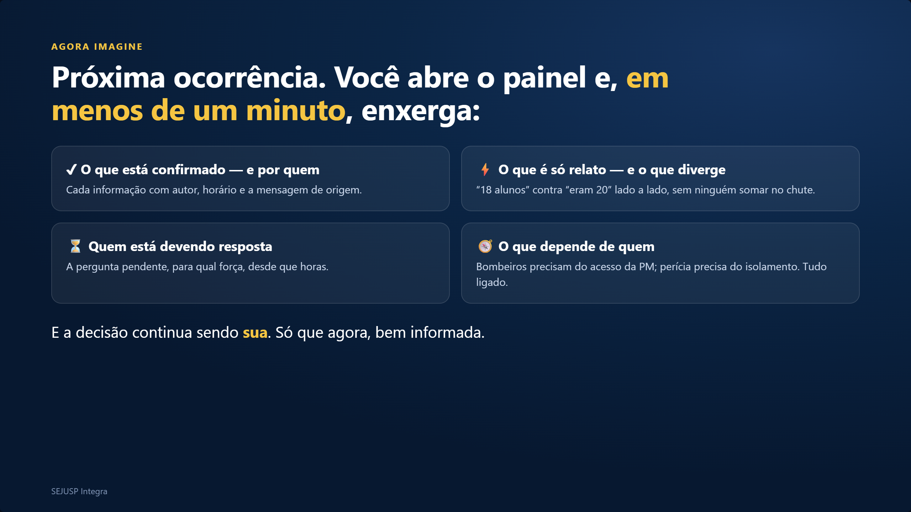
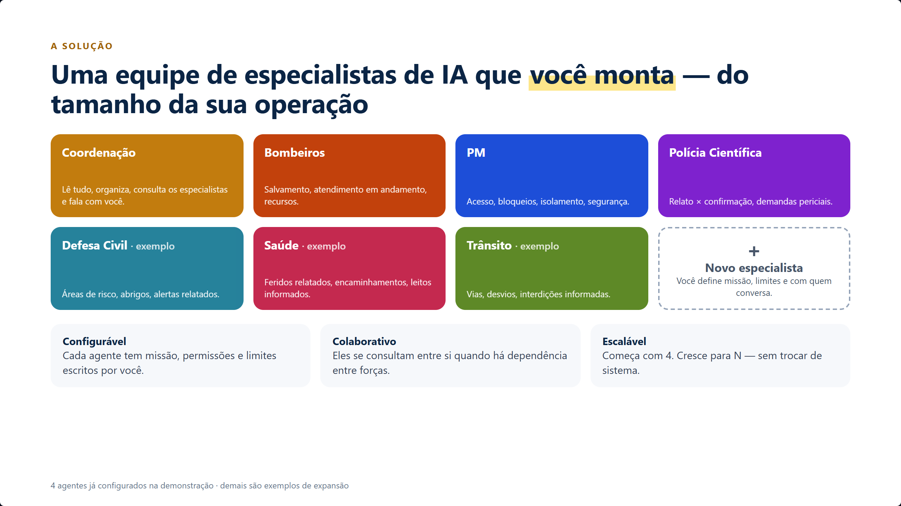
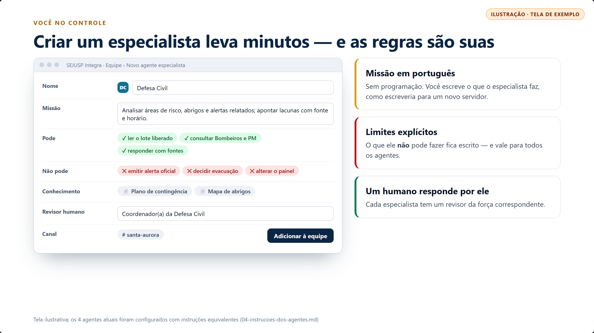
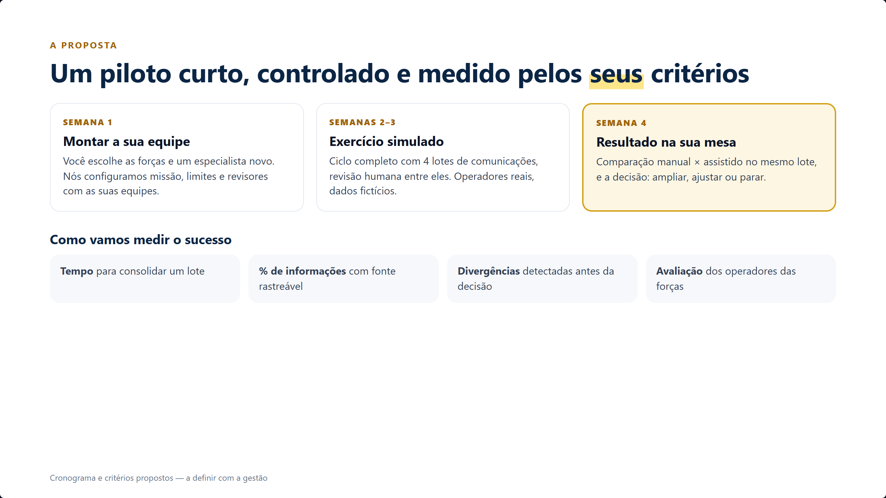

# Roteiro do pitch — SEJUSP Integra para a gestão

Apresentação: [index.html](index.html) (tecla **N** mostra este roteiro durante a apresentação). Tempo total: ≈ 10 min. Cada slide traz, em itálico, as técnicas de persuasão usadas — material interno, não mostrar ao gestor.

> Todas as telas marcadas “Ilustração · tela simulada” mostram o comportamento esperado do fluxo; a única captura real está no slide 9. Material inteiramente fictício.

## 1. Abertura

**Abertura — 45 s.** Comece em silêncio por 2 segundos, olhe para o gestor e diga devagar: “14h12. Uma enchente. Uma escola isolada.” Depois leia o título. Não se apresente ainda: o gancho vem antes do currículo.Técnicas: gancho narrativo (padrão de interrupção), pressuposição (“a informação já tinha chegado” pressupõe que o problema é organização, não falta de dados), linguagem de controle (“configurada por você”, “nas suas mãos”).

## 2. Você já viveu isso

**Rapport — 60 s.** Leia cada item e faça uma pausa curta, olhando para o gestor. Espere o aceno. Se a pessoa gestora comentar um caso real, ouça e repita as palavras dela: elas valem mais que as nossas.Frase de ponte: “Ninguém está errado” — protege o orgulho das equipes atuais e evita que o gestor defenda o processo atual.Técnicas: sequência de “sim” (yes-set), acompanhar antes de conduzir (pacing → leading), validar o status quo sem atacá-lo.

## 3. O custo de não mudar

**Dor — 60 s.** Leia a fala da mãe em tom baixo, sem dramatizar. Pausa de 3 segundos. Depois: “Nesse momento o Bombeiro sabe…, a PM sabe…, a escola sabe… Ninguém vê as três coisas juntas.”Não cite números de perda: não temos medição, e um gestor experiente desconfia de número inventado. A dor fala por si.Técnicas: história com rosto humano (âncora emocional), aversão à perda (custo da inação), linguagem visual (“vê”, “juntas”).

## 4. Imagine

**Futuro projetado — 60 s.** Fale no presente, como se já estivesse acontecendo: “Você abre o painel… você enxerga…”. Aponte para cada cartão.“Em menos de um minuto” refere-se a ler o painel, não a gerar o painel — se questionado, diga exatamente isso.Técnicas: future pacing (o gestor se vê usando o produto), comando embutido (“imagine”, “enxerga”), reforço de autonomia (“a decisão continua sendo sua”).

## 5. Sua equipe de agentes

**Produto — 75 s.** Linha principal: “Não é um robô genérico. É uma equipe que você monta.” Mostre os 4 que já existem (cores fortes) e depois os exemplos (mais claros), terminando no “+”. Pergunte: “Qual especialista você colocaria aqui primeiro?” — e anote a resposta: ela será usada no fechamento.Seja honesto: os exemplos ainda não foram configurados.Técnicas: propriedade psicológica (efeito IKEA — o que a pessoa monta, ela valoriza), pergunta de envolvimento, escada de valor (4 → N).

## 6. Você configura

**Configuração — 60 s.** Se a gestão respondeu no slide anterior, troque mentalmente “Defesa Civil” pelo especialista citado: “Imagine o seu agente de ___ aqui”.Ênfase em “Não pode”: é aqui que o gestor sente segurança.Técnicas: controle percebido (reduz risco percebido), analogia familiar (“como escreveria para um novo servidor”), personalização com as palavras do cliente.

## 7. Você pergunta, a equipe responde

**Interação — 75 s. É o slide que vende.** Leia a pergunta do gestor em voz alta como se fosse a própria gestão perguntando. Depois percorra a resposta: confirmado, relatado, aguardando. Termine em “Decisão necessária” e diga: “Perceba quem decide aqui.” Pausa.Se houver tempo e conexão, faça esta pergunta ao vivo no canal real — a demonstração ao vivo vale mais que qualquer slide. Tenha este slide como plano B.Técnicas: demonstração do benefício (mostrar &gt; dizer), contraste (“sem ligar para três pessoas”), comando embutido (“perceba quem decide”).

## 8. Suas dúvidas, respondidas

**Objeções — 75 s.** Antecipar as objeções mostra domínio e tira do gestor o papel de “advogado do diabo”. Responda de forma curta; se houver aprofundamento, ótimo, é sinal de interesse.Sobre custo: não citar valores que não temos; foque em “risco operacional zero no piloto”. Se perguntarem preço, diga: “Vamos dimensionar juntos depois do piloto, com base no que você decidir manter.”Técnicas: inoculação (tratar objeções antes que surjam), enquadramento de risco baixo, transferência de autoridade para o processo (“testamos de propósito”).

## 9. Não é promessa

**Prova — 60 s.** Aponte para a captura: “Isto não é desenho; é o sistema rodando.” Seja preciso: a captura é da demonstração DEMO-001, com a primeira versão da carga; o ciclo completo dos 4 lotes ainda será executado — e isso vira argumento: “É exatamente isso que queremos fazer com você.”Nunca exagere aqui: se o gestor descobrir um exagero, a venda inteira cai.Técnicas: prova concreta (reduz incerteza), transparência como credibilidade, transformar a lacuna em convite (“com você”).

## 10. A proposta

**Oferta — 60 s.** Apresente como algo pequeno e reversível: “quatro semanas, sem tocar na operação, e você decide no fim”. A saída fácil (“ou parar”) aumenta a chance de o “sim” acontecer.Pergunte: “Algum desses critérios você trocaria?” — quem ajusta os critérios já está dentro do projeto.Técnicas: pé na porta (pedido pequeno primeiro), reversibilidade (reduz medo de errar), coautoria dos critérios (compromisso), ancoragem no resultado final.

## 11. Fechamento

**Fechamento — 45 s.** Recapitule os três pontos (regra de três). Diga a frase final devagar. Depois faça a pergunta do botão e **fique em silêncio**: quem fala primeiro depois da pergunta de fechamento perde força.Se houver hesitação, use a pergunta alternativa: “Começamos com a enchente ou com outro cenário?” — as duas respostas levam ao piloto.Técnicas: regra de três, fechamento por alternativa (escolha entre dois “sins”), pressuposição (“qual força entra primeiro” pressupõe que o piloto acontece), retomada do gancho inicial (circularidade da história), silêncio estratégico.
